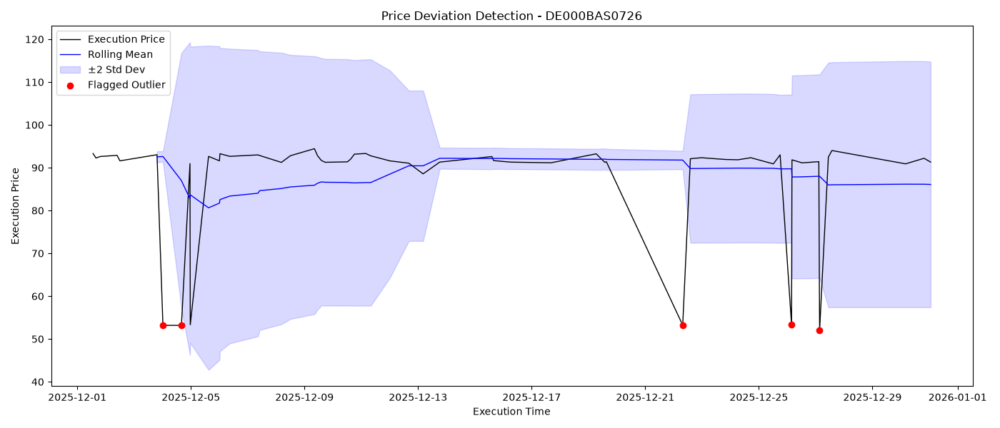
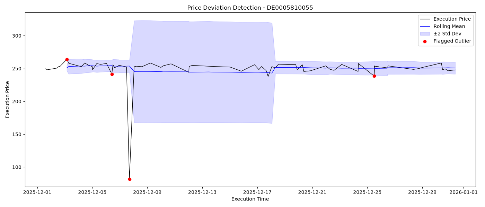
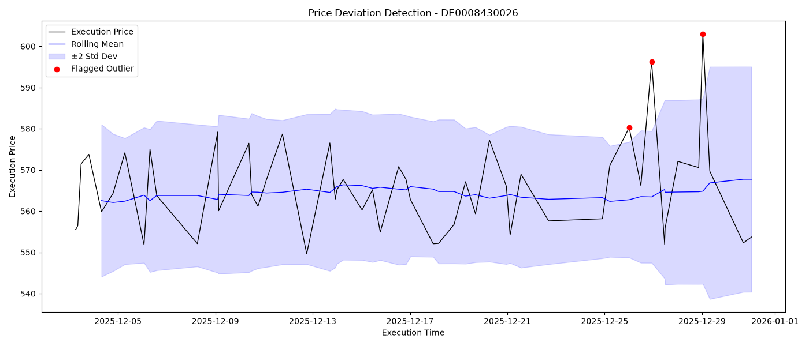
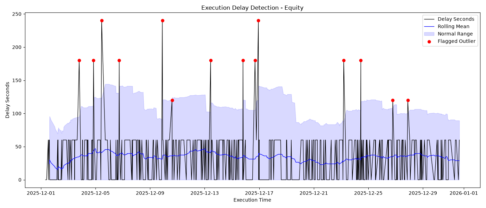

# Erkenntnisse: Was die Diagramme jenseits der Tabellen offenbaren

Dieser Teil war urspruenglich nur als einfache Visualisierung gedacht, um die
Entscheidungslogik der vorherigen Layer anschaulich darzustellen. Nach der
eigentlichen Umsetzung stellte sich jedoch heraus, dass die Diagramme Details
aufdecken koennen, die selbst beim Ausdrucken aller relevanten Spalten und
zeilenweisen Abgleich der Daten nicht erkennbar sind. Diese unerwartete
Erkenntnis hat mich dazu gebracht, die Rolle dieses Layers neu zu definieren:
Er ist nicht mehr nur eine Wiederholung der vorherigen Ergebnisse, sondern die
einzige Stelle in diesem Projekt, an der sich derartige methodische blinde
Flecken aufdecken lassen.

## Erkenntnis 1: Die Schwellenwert-Sensitivitaet wird durch die eigene Historie des Wertpapiers geformt

Abbildung 1 zeigt, dass der dritte extreme Ausreisser Anfang Dezember nicht
erfasst wurde - dem Diagramm nach, weil er durch die hellblaue Flaeche
(untere Grenze) "geschuetzt" wurde. Der Grund, warum diese Flaeche so weit
nach unten gezogen wurde, ist einfach: Kurz vor diesem dritten Wert waren
bereits zwei Ausreisser in dieselbe Richtung aufgetreten, zeitlich sehr nah
beieinander. Dadurch wurden bei der Bewertung des dritten Ausfuehrungspreises
sowohl der Mittelwert als auch die untere Grenze stark nach unten gezogen, sodass
dieser Wert "uebermaessig geschuetzt" wurde und unentdeckt blieb. Dies zeigt,
dass aufeinanderfolgende Extremwerte in dieselbe Richtung den Schwellenwert
"verwoehnen" koennen (Masking-Effekt), sodass nachfolgende echte Ausreisser
durchrutschen (falsch negativ).

Im Vergleich dazu fuehrt bei Abbildung 2 die relativ stabile Historie dazu,
dass der Schwellenwert extrem sensibel wird und bereits leichte Schwankungen
ueberproportional markiert werden (moegliche Falsch-Positive).

Beide Faelle zeigen, dass der Massstab der rollierenden Schwellenwertmethode
nicht absolut ist, sondern durch den Charakter der jeweiligen Historie selbst
geformt wird - das ist zugleich ihre Staerke (Anpassungsfaehigkeit) und ihre
Schwaeche (Anfaelligkeit fuer Verzerrung oder Uebersensibilitaet).

<table>
<tr>
<td width="50%" align="center"> <em>(Abbildung 1)</em></td>
<td width="50%" align="center"> <em>(Abbildung 2)</em></td>
</tr>
</table>

## Erkenntnis 2: Der Cold-Start-Blind-Spot - sichtbar oder verborgen, je nach Handelsfrequenz

In Abbildung 3 ist zu erkennen, dass die hellblaue Schutzflaeche nicht von
Beginn des Handels an vorhanden ist - der Bereich davor (eine deutlich
sichtbare Luecke) ist die sogenannte Cold-Start-Phase. In diesem konkreten
Fall scheint innerhalb der Cold-Start-Phase keine auffaellige Schwankung
aufzutreten, doch genau darin liegt das eigentliche Risiko: Selbst wenn der
Ausfuehrungspreis in dieser Phase stark abweichen wuerde, koennte dies nicht
erkannt werden, da fuer die Cold-Start-Phase schlicht kein Referenzwert zur
Bewertung existiert (das heisst: Faende in dieser Luecke tatsaechlich eine
Preismanipulation statt, waere das System vollkommen blind!).

Im Vergleich dazu ist die Cold-Start-Phase in Abbildung 4 kaum wahrnehmbar -
aus einem einfachen Grund: Die sehr hohe Handelsdichte fuehrt dazu, dass die
ersten 5 Ausfuehrungen auf der Zeitachse nur eine minimale Breite einnehmen,
wodurch sie mit blossem Auge nicht mehr erkennbar sind. Dies zeigt zugleich,
dass die Cold-Start-Phase je nach Wertpapier unterschiedlich leicht
uebersehen werden kann. Der eigentliche Erkenntniswert liegt darin, dass das 
Risiko des "Cold-Start-Blind-Spots" im Kontext des Hochfrequenzhandels - unabhaengig vom jeweiligen Finanzprodukt - tendenziell unauffaelliger (und damit leichter zu uebersehen) ist.

<table>
<tr>
<td width="50%" align="center"> <em>(Abbildung 3)</em></td>
<td width="50%" align="center"> <em>(Abbildung 4)</em></td>
</tr>
</table>
